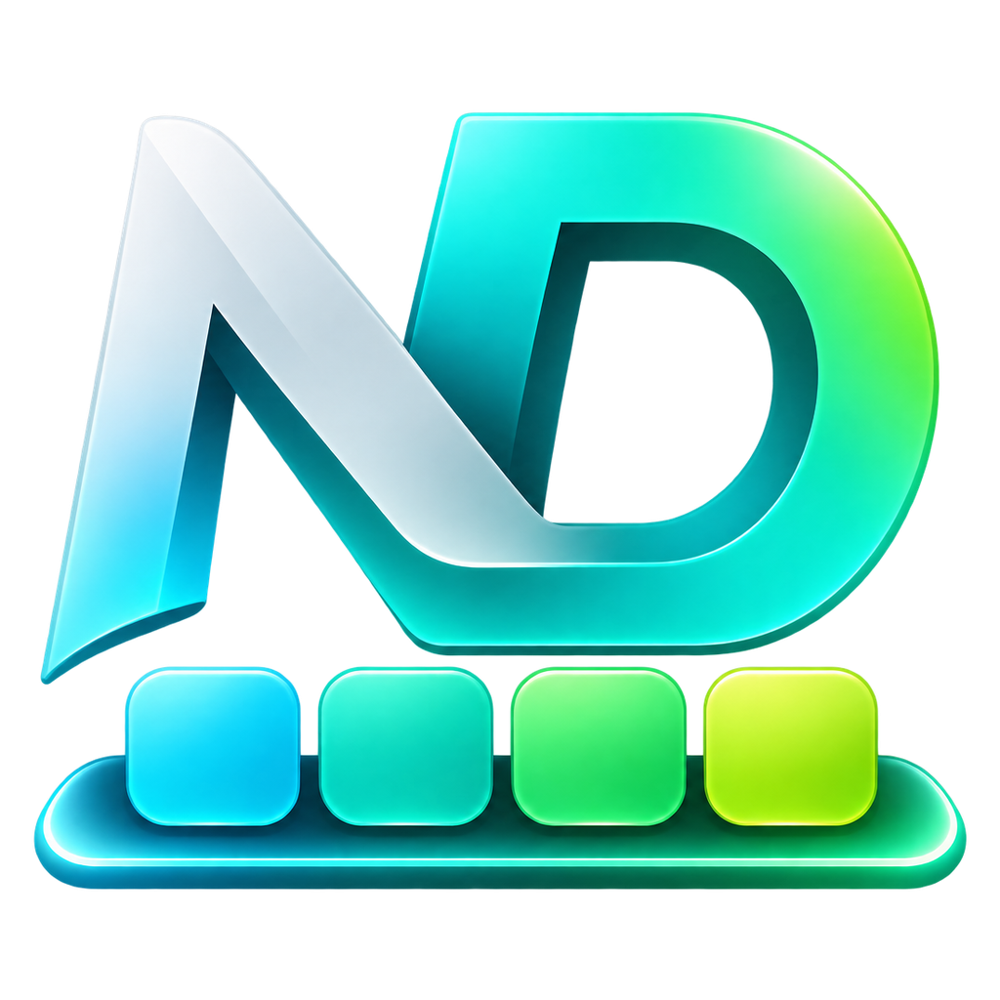

<p align="center"></p>

# NETDock

A RocketDock-style dock for Windows. It is a single native .NET 11 AOT executable (about 4 MB) with no runtime, WebView or browser engine. It draws with Direct2D into a per-pixel-alpha layered window.

## Install

1. Download `NETDock.exe` from the [latest release](https://github.com/matt020191/NETDock/releases/latest). It is signed by M-TEC SYSTEMS, INC.
2. Run it. On first run it offers to install. *Yes* installs it for your user only, with no admin rights needed:
   - the exe goes to `%LocalAppData%\Programs\NETDock`
   - it adds a Start menu shortcut and an entry in *Settings → Apps*
   - settings live in `%APPDATA%\NETDock`

   Choose *No* to just run it where it is.
3. To start it with Windows, use right-click → *Options → Start with Windows*.

**Portable:** download `NETDock-<version>-portable.zip` instead and extract it anywhere, such as a USB stick. The `portable` marker in the zip keeps all settings in `Data\` next to the exe. A portable copy never offers to install. You can install it later with right-click → *Settings → Install NETDock*, and its icons and settings come with it.

**Uninstall:** use *Settings → Apps → NETDock → Uninstall*, or run `NETDock.exe --uninstall`. This removes the program, the shortcut and the startup entry. It asks whether to keep your icons and settings.

## Updates

NETDock checks GitHub for a new release about once a day. Turn this off with right-click → *Settings → Check for updates automatically*. When an update is found, a tray notification appears. Click it to see the release notes, then:
- *Yes* installs the update and restarts the dock
- *No* skips that version

To check by hand, use *Settings → Check for updates now*.

Before an update is installed, the download must:
- match the release's published SHA-256
- carry a valid Authenticode signature, with revocation checked
- be signed by exactly M-TEC SYSTEMS, INC.

If any check fails, nothing is replaced. If the swap itself fails, the previous version is put back.

## Build

```
dotnet test NETDock.Tests
dotnet publish NETDock.App -c Release -o out/NETDock
```

## Layout

| Project | What |
| --- | --- |
| `NETDock.Core` | Settings model + JSON (source-generated), portable data location, path tokens, RocketDock importer, magnification maths. No Win32 dependencies; covered by tests. |
| `NETDock.App` | The dock: raw-vtable Direct2D/DirectWrite (`Native/Direct2D.cs`), Shell COM (`Native/Shell.cs`), dock window, stack flyout, menus, properties dialog. |
| `NETDock.Tests` | xunit tests for Core. |

## RocketDock bugs this fixes

1. **Stacks lose their folder/icon on restart.** RocketDock saves a stack's settings in `Docklets\Settings.ini` as `[DockletN]`, where N is the icon's position at the time. Moving or inserting icons orphans that section. NETDock stores `StackOptions` (folder, view, sort, columns) on the item itself. The importer also recovers orphaned sections.
2. **Not portable.** If a `portable` file or a `Data` folder sits next to `NETDock.exe`, everything lives in `.\Data`; otherwise it lives in `%APPDATA%\NETDock`. Paths are stored with tokens (`%ProgramFiles%`, `%USERPROFILE%`, `%NETDOCK%` …). Custom icons are copied into `Data\icons`. *Settings → Export backup* writes one zip that *Import backup* restores on another PC.
3. **Start In flips to Program Files (x86).** RocketDock is 32-bit, so WOW64 redirects its paths. NETDock is x64-only. It tokenizes on whole path segments, keeps `.lnk` files as `.lnk` (so the shortcut's own Start In applies), and never rewrites a stored path. On import, it repairs paths that RocketDock already redirected.

## Usage

- Drag files, shortcuts or folders onto the dock to add them. A folder becomes a stack.
- Drag icons to reorder them. Drag one off the dock to remove it (*Options → Lock icons* prevents this).
- Click a running app to switch to it; click it again to minimise it. Shift+click or middle-click starts a new copy. Ctrl+Shift+click runs it as administrator.
- Right-click for everything else: Properties, Change icon, stack view/sort/columns, position, sizes and Settings.
- `NETDock.exe --import-rocketdock` imports your RocketDock setup without asking.
- `NETDock.exe --mode 2` (or `--mode next`) switches the running dock to another mode: a set of icons made under right-click > Mode, with an optional saved window layout.

## Translations

The interface is English, and every string goes through `L.T("English text")`, with the English text as the key.

1. Copy `languages\template.json` (next to `NETDock.exe`) to `languages\<Language>.json`, for example `languages\Deutsch.json`.
2. Fill in the values. Leave `{0}`, `{1}` and `\n` as they are. Anything left empty stays in English.
3. Pick the language in *Dock Settings → General*. It applies to menus and windows opened after that.

A language file in the data folder (`Data\languages`) takes priority over the one next to the exe, so it travels with portable settings. `NETDock.App\languages\template.json` is generated by a unit test. If you add or change a string, run the tests once and commit the updated template.

## Credits

Ported in spirit from [Aero Dock](https://github.com/TheAgencyMGE/aero-dock) (MIT, © 2026 Ryan Panda). Its platform layer (app discovery, Shell icon extraction, running-window tracking) informed the Win32 code here. See `THIRD-PARTY-NOTICES.md`.
